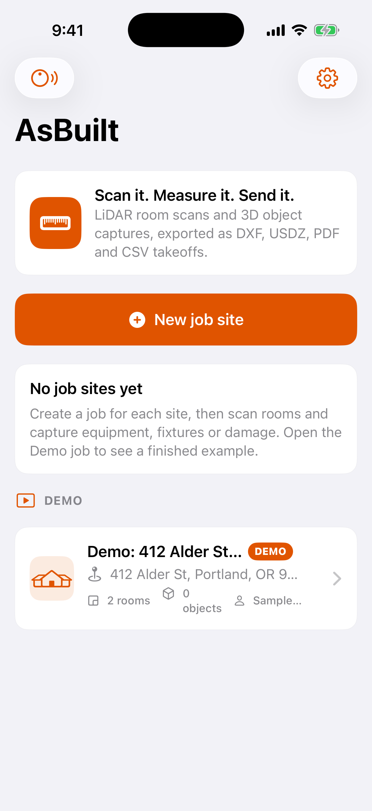
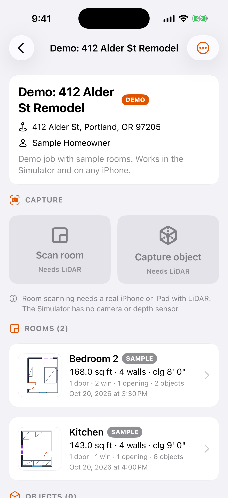
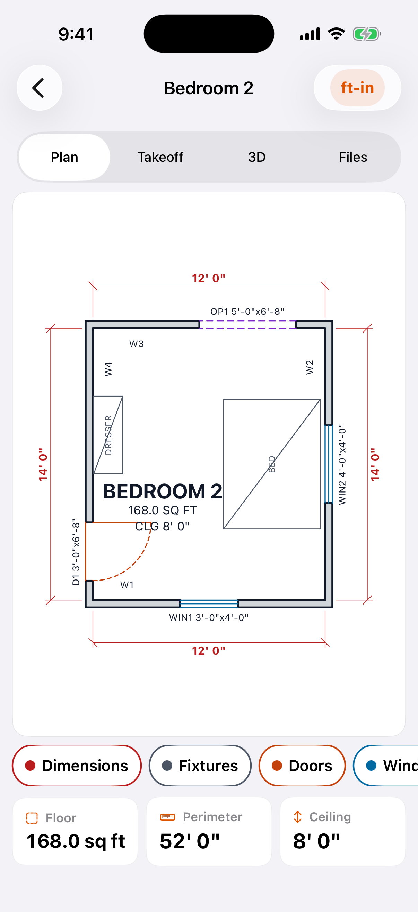
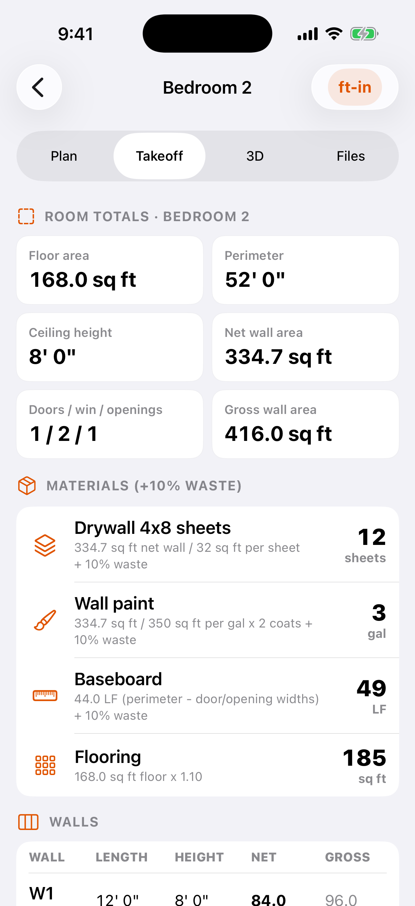
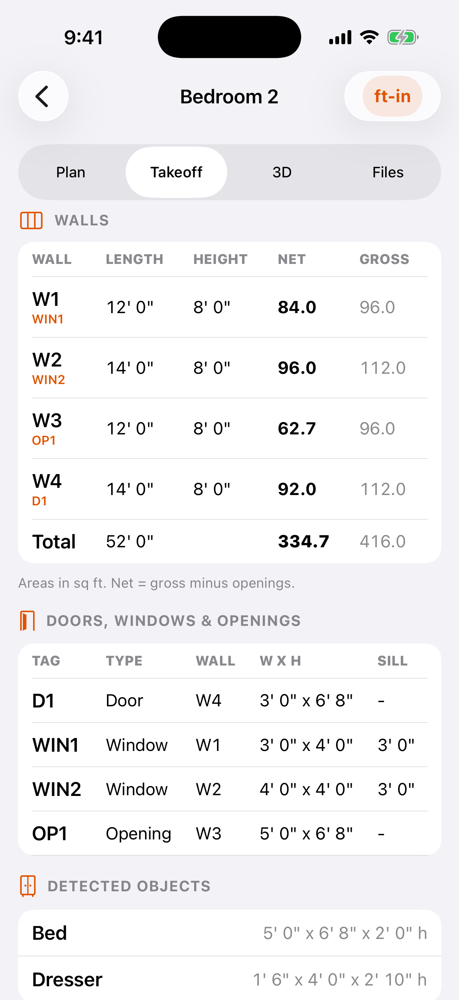
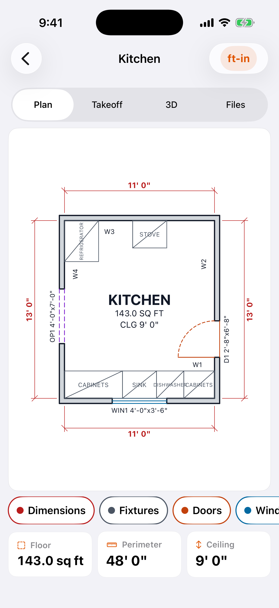
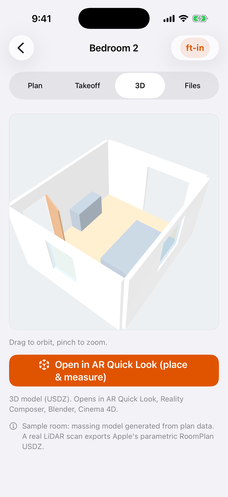
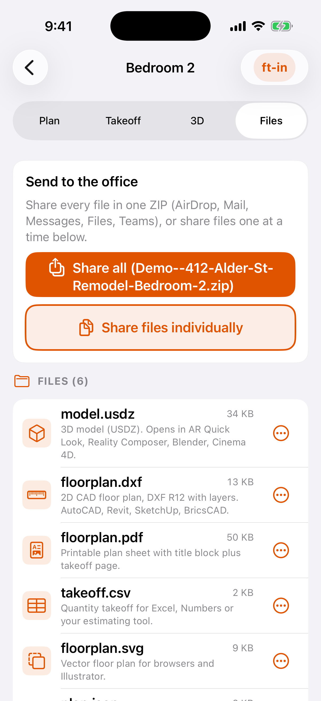

# AsBuilt

An iOS app for construction crews. Point an iPhone's LiDAR camera at a room or an object and get files the
office can use: a CAD floor plan (DXF), a 3D model (USDZ), a printable plan with a quantity takeoff (PDF)
and a spreadsheet takeoff (CSV).

| Job list | Demo job | Floor plan | Takeoff |
| --- | --- | --- | --- |
|  |  |  |  |
| **Per-wall takeoff** | **Kitchen plan** | **3D / AR Quick Look** | **Share / export** |
|  |  |  |  |

Screenshots come from the iOS Simulator in CI (`scripts/capture-screenshots.sh`) using the built-in Demo job.

## What it does

- **Jobs.** Create job sites (name, address, client, notes). Each job holds its room scans and object captures.
  Everything is stored on the phone in `Documents/Jobs/<jobId>/<captureId>/`, which also shows up in the
  Files app (On My iPhone › AsBuilt).
- **Room scan (Apple RoomPlan).** Guided LiDAR scan with Apple's on-screen coaching. When you tap Done the
  room is processed and saved as:
  - `room.usdz`: parametric 3D room model from `CapturedRoom.export(... .parametric)`
  - `room.json`: the raw `CapturedRoom`, so it can be processed again later
  - `plan.json`: AsBuilt's 2D plan data (walls, openings, fixtures) in meters
  - `floorplan.dxf`: 2D CAD plan (details below)
  - `floorplan.pdf`: plan sheet with a title block, legend and scale bar, plus a takeoff page
  - `floorplan.svg`: vector plan for browsers and Illustrator
  - `takeoff.csv`: the quantity takeoff
- **Takeoff.** Shown in the app and written to the CSV and PDF:
  - **Per wall:** length, height, gross area, opening area and net area. Overlapping openings are only subtracted once.
  - **Room:** floor area (from the scanned floor polygon, else the closed wall loop), perimeter, ceiling height,
    and counts of doors, windows and openings.
  - **Materials, including 10% waste (adjustable in Settings):**
    - drywall 4x8 sheets = net wall area / 32 sq ft
    - paint gallons = net area / 350 sq ft x 2 coats
    - baseboard LF = perimeter minus door and opening widths
    - flooring sq ft = floor area x 1.10
  - Imperial (ft-in) is the default. Switch to metric from the units button on any plan screen.
- **Object capture (RealityKit Object Capture).** Guided photo capture of equipment, fixtures or damage. The
  phone then reconstructs `model.usdz` on-device with `PhotogrammetrySession`. The `Images/` folder is kept so
  the office can rebuild the model at higher detail on a Mac. You can also import a USDZ made elsewhere.
- **Viewing and sharing.**
  - Interactive 3D preview (SceneKit) plus **AR Quick Look**, which places the model in the room at true scale and measures it.
  - 2D plan view you can pinch to zoom, with dimensions and layer toggles.
  - Takeoff tables.
  - **Share all** builds one ZIP of every file for AirDrop, Mail, Messages or Teams. Files can also be shared one at a time.
- **Device check** screen. Tells you plainly whether this device can scan rooms or capture objects, and why not if it can't.
- **Demo job** ("412 Alder St Remodel") with two sample rooms, so you can try plans, takeoffs, 3D and exports
  on any iPhone or in the Simulator:
  - a 12' x 14' bedroom with a door, two windows, a closet opening, a bed and a dresser
  - an 11' x 13' kitchen with cabinets and appliances

## Device requirements

| Feature | Needs |
| --- | --- |
| Room scanning | LiDAR: iPhone 12 Pro / Pro Max or any later **Pro** iPhone, or iPad Pro (2020+). iOS 17+. |
| Object capture + on-device 3D model | LiDAR iPhone/iPad Pro, iOS 17+ |
| Demo job, plans, takeoffs, 3D viewer, exports | Any iPhone or iPad on iOS 17+, and the Simulator |

## Install on your own iPhone (free, no developer account)

1. On a Mac, install **Xcode** (16 or newer) from the App Store.
2. Clone this repo and open `AsBuilt.xcodeproj`.
3. Select the **AsBuilt** target › *Signing & Capabilities* › tick *Automatically manage signing* and set **Team** to
   your personal Apple ID (Xcode › Settings › Accounts › "+" if it isn't listed). If Xcode says the bundle ID
   is taken, change `com.moltstrong.asbuilt` to something unique, e.g. `com.yourname.asbuilt`.
4. Plug in the iPhone, unlock it, tap *Trust*, and pick it as the run destination in the Xcode toolbar.
5. Press **Run** (⌘R). The first time, enable Developer Mode on the phone (Settings › Privacy & Security ›
   Developer Mode), then trust your developer certificate (Settings › General › VPN & Device Management).
6. Free provisioning expires after **7 days**. Press Run again to reinstall.

For the whole crew, join the Apple Developer Program ($99/yr), then *Product › Archive › Distribute App ›
TestFlight* and invite testers by email.

To regenerate the project after adding files: `brew install xcodegen && xcodegen generate` (the spec is `project.yml`).

## How the CAD / estimating team uses the files

- **DXF (`floorplan.dxf`):** ASCII **DXF R12** (AC1009), the most widely compatible flavour. It opens in AutoCAD,
  Revit (Insert › Import CAD), SketchUp (File › Import), BricsCAD, LibreCAD, QCAD, Rhino and Illustrator.
  - **Units:** `$INSUNITS` is set (inches for imperial, millimeters for metric), so it inserts at true scale.
  - **Layers:** `WALLS` (both wall faces, broken at openings), `DOORS` (leaf + swing arc), `WINDOWS`,
    `OPENINGS` (dashed), `FIXTURES` (labeled bounding boxes for cabinets, appliances, toilets, sinks…),
    `DIMENSIONS` (wall-length dimensions with ticks) and `TEXT` (room name, area, ceiling height, wall tags W1…,
    opening tags like `D1 3'-0"x6'-8"`, and job notes).
  - Dimensions are measured on the interior wall face, which is what RoomPlan reports. Walls are drawn 4½" thick
    outward from that face. Trace over it in your CAD template or use it directly as an existing-conditions
    underlay.
- **USDZ (`room.usdz` / `model.usdz`):**
  - **Quick look on Mac or iPhone:** tap the file to open it in AR Quick Look, then view it in the room at true scale.
  - **Editing:** open it in Blender (File › Import › USD), Reality Composer Pro, Cinema 4D or Maya.
  - **Revit/SketchUp:** import through a USD plugin or convert to OBJ/FBX.
  - Room scans are parametric, so walls, doors and windows come through as clean boxes.
  - For object captures, the `Images/` folder can be reconstructed at *Full* or *Raw* detail on a Mac with
    Reality Composer Pro (File › New › Photogrammetry) or `PhotogrammetrySession`.
- **CSV (`takeoff.csv`):** one header row, one line item per row: Room totals, Walls, Openings, Fixtures and Materials.
  Each row has length, height, gross, opening and net area, quantity, order quantity (rounded up) and unit.
  Drop it into Excel, Numbers, Google Sheets or your estimating tool.
- **PDF (`floorplan.pdf`):** page 1 is the plan sheet with a title block, page 2 is the takeoff, ready to print or attach to a bid.
- **JSON:** `room.json` is Apple's `CapturedRoom` (Codable). `plan.json` is AsBuilt's own plan model, in meters.

## Project layout

```
AsBuiltCore/      Swift package with all platform-independent logic (no RoomPlan), with unit tests
  Geometry, Models          Point2D, WallSegment, Opening, FixtureBox, FloorPlan, polygon math
  WallLoop, Normalization   wall-loop closing, wall ordering (W1 = south wall, counter-clockwise)
  Takeoff                   TakeoffCalculator (areas, counts, materials, waste)
  Units                     ft-in / metric formatting
  PlanDrawing               plan geometry (wall faces, door swings, dimensions, labels)
  DXFWriter, SVGRenderer, CSVWriter, ZipWriter
AsBuilt/          SwiftUI iOS app
  Capture/        RoomPlan scanner + CapturedRoom → FloorPlan adapter, Object Capture flow, capability checks
  Export/         PDF renderer, SceneKit USDZ massing model, export/zip service
  Views/          jobs, plan canvas, takeoff, 3D/AR Quick Look, files/share, device check, settings
AsBuiltTests/     XCTest app tests (run in the Simulator in CI)
project.yml       XcodeGen spec (AsBuilt.xcodeproj is generated from it and committed)
.github/workflows/ios.yml   CI: swift test, simulator build + tests, device build, screenshots
```

CapturedRoom is turned into a plan by projecting each surface onto the floor (XZ) plane:

- center = `transform.columns.3`
- direction = `transform.columns.0`
- length = `dimensions.x`
- height = `dimensions.y`

Plan coordinates are `(x, -z)`. Doors and windows are attached to their host wall through `parentIdentifier`;
if that's missing, the nearest parallel wall is used.

## Development

```bash
cd AsBuiltCore && swift test        # core logic tests (works with just the Command Line Tools)
xcodegen generate                   # regenerate AsBuilt.xcodeproj from project.yml
xcodebuild -scheme AsBuilt -destination 'platform=iOS Simulator,name=iPhone 17 Pro' test
```

Launch arguments for demos and screenshots: `-AsBuiltScreen jobs|job|plan|takeoff|takeoff-walls|kitchen|model|files|capabilities|settings`
and `-AsBuiltResetDemo YES`.

## Status and limitations

- Device-only paths are compile-verified for `generic/platform=iOS` in CI but have **not been run on a physical
  LiDAR device yet**: the RoomPlan scanner, the `CapturedRoom` → plan adapter, Object Capture and on-device
  reconstruction. Expect some tuning after the first real scans.
- Each scan is one room. Merging several rooms with `StructureBuilder` is not implemented.
- Curved walls are exported as straight chords. Sloped ceilings report the tallest wall height.
- Sample rooms use a generated SceneKit massing model. Real scans use Apple's RoomPlan USDZ.
